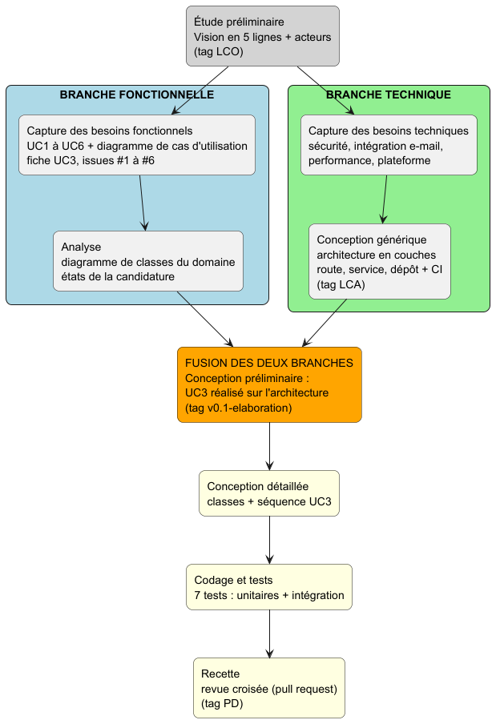
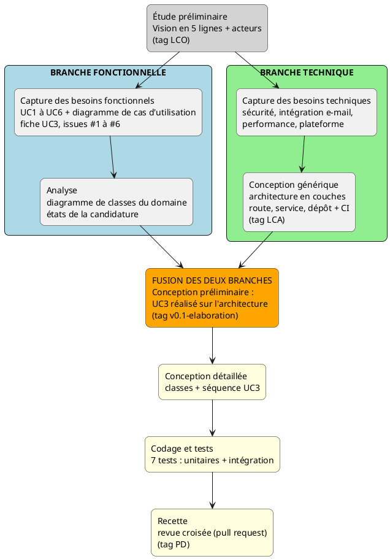

# TP2 : Exigences, modèle en Y et contraintes techniques

**Projet :** Gestion de stages (offres, candidatures, suivi par l'encadrant)
**Dépôt :** https://github.com/NourMahmoud151515/Processus-Unifi-s

---

## 1. Classement des exigences

| Fonctionnel | Technique |
|---|---|
| **EF1** La RH publie une offre de stage (UC1) | **ET1 Sécurité** : authentification et droits par rôle (étudiant, RH, encadrant) ; seule la RH peut accepter ou refuser une candidature |
| **EF2** L'étudiant postule à une offre avec son CV et sa lettre (UC2) | **ET2 Intégration** : envoi des e-mails via un serveur SMTP externe, de façon asynchrone, avec 3 réessais |
| **EF3** La RH accepte ou refuse une candidature (UC3) | **ET3 Fiabilité et cohérence** : une candidature ne change d'état que depuis EN_COURS ; un échec d'envoi d'e-mail n'annule jamais la décision |
| **EF4** L'étudiant consulte l'état de sa candidature (UC4) | **ET4 Performance** : consultation de l'état en moins de 2 secondes pour 500 utilisateurs simultanés |
| **EF5** L'étudiant dépose son journal et son rapport de stage (UC5) | **ET5 Plateforme** : application web Python (FastAPI), accessible depuis un navigateur sur ordinateur et sur mobile |
| **EF6** L'encadrant valide le rapport et délivre l'attestation (UC6) | **ET6 Maintenabilité** : architecture en couches (route, service, dépôt) et tests automatisés en intégration continue (GitHub Actions) |
| | **ET7 Stockage** : fichiers (CV, rapports) limités en taille et en format (PDF, 5 Mo maximum) |

> Les valeurs chiffrées (2 secondes, 500 utilisateurs, 5 Mo) sont des hypothèses de travail.

---

## 2. Le Y du projet

Source PlantUML : `docs/y-model.puml`

### Livrables du TP1 placés dans le Y

| Livrable | Emplacement dans le Y | Trace dans le dépôt |
|---|---|---|
| Vision et acteurs | Étude préliminaire (sommet du Y) | Tag `LCO` |
| Cas d'utilisation | Branche fonctionnelle | `docs/diagrams/use-cases.puml`, issues #1 à #6 |
| Architecture (route, service, dépôt, CI) | Branche technique | Dossier `app/`, `.github/workflows/ci.yml`, tag `LCA` |
| Fusion des deux branches | Conception préliminaire : le UC3 est réalisé sur l'architecture | PR #8, tag `v0.1-elaboration` |
| Tests | Après la fusion, dans « Codage et tests » | `tests/test_uc3.py` (7 tests) |
| Revue croisée | Recette, en fin de Y | Pull request relue par une autre équipe |

**Point de fusion :** la branche fonctionnelle (UC et classes du domaine) et la branche technique (architecture et contraintes) se rejoignent à la **conception préliminaire**. Le UC3, cas fonctionnel à risque, est réalisé de bout en bout sur l'architecture technique.

---

## 3. Questions

### Quelle contrainte technique a influencé le choix du UC à risque ?

La contrainte d'**intégration** avec un service d'e-mail externe, qui peut tomber en panne ou répondre lentement, combinée à l'exigence de **cohérence d'état**. Le UC3 réunit les deux : il change l'état d'une candidature (machine à états, une seule décision autorisée), puis déclenche une notification externe. Il fallait donc démontrer tôt que la décision reste valide même si l'envoi échoue. C'est pourquoi le UC3 a été traité en premier, avec des réessais et un test dédié.

### Qu'auriez-vous changé si la contrainte avait été une application mobile hors-ligne ?

- **UC à risque :** la **synchronisation**, par exemple le dépôt du journal de stage (UC5) saisi sans réseau. Le UC3 deviendrait secondaire.
- **Architecture :** stockage local sur l'appareil (SQLite), file d'opérations à rejouer, API **idempotente** et stratégie de résolution des conflits (dernière modification gagnante ou fusion par version).
- **Notifications :** notifications push à la place des e-mails.
- **Tests :** tests de synchronisation (coupure réseau, reprise, doublons) et tests de conflits.
- **Planification :** une itération d'élaboration supplémentaire pour valider la synchronisation avant de construire les autres UC.